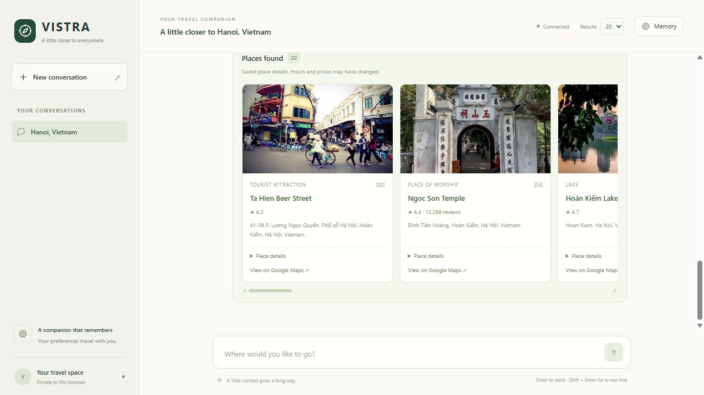
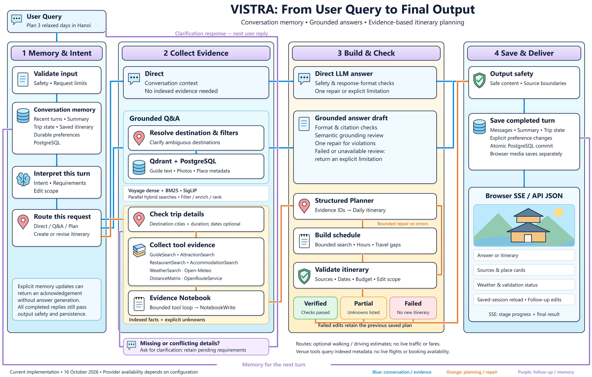

# VISTRA

**Your travel companion, with memory.**

VISTRA is an AI travel assistant for grounded Q&A and multi-turn itinerary planning. It remembers your preferences, retrieves travel guides and place photos, and brings weather into plans you can refine through conversation.

## A look inside



Chat naturally, explore photos and place details beneath each reply, and revisit your saved conversations.

## From question to trip



PostgreSQL holds conversation memory and indexed place metadata; Qdrant retrieves guide and photo evidence. Grounded answers receive format, citation and grounding checks. Itineraries follow a TravelPlanner-style tools → notebook → planner → schedule construction flow, with constraint checks and bounded repair before delivery. Optional OpenRouteService estimates support travel-time checks; missing evidence stays explicit in partial drafts.

See the [pipeline review](assets/readme/vistra-pipeline-review.md) for implementation references and availability limits.

## Get started

This GitHub distribution excludes the local `frontend/` and `api/` folders,
model caches, indexed datasets, and the benchmark golden set. The browser/API
instructions below describe a full local checkout. Railway and Vercel entry
points require the excluded `api/` package and cannot deploy from this source
distribution alone. The golden dataset is planned for separate Hugging Face
publication; see [benchmark publication notes](benchmarks/README.md#github-publication).

Use the existing `.env`, model cache, and indexed datasets. New installations need provider keys and PostgreSQL settings; see the [setup guide](api/README.md).

Run from the project root on Windows; create `.venv` with `python -m venv .venv` if needed:

```powershell
.\.venv\python.exe -m pip install -r requirements.txt
docker compose -f compose.postgres.yaml -f compose.qdrant.yaml up -d
.\.venv\python.exe -B -m frontend.server
```

Open **[VISTRA chat](http://127.0.0.1:8000)**. Try “Plan three relaxed days in Hanoi,” then “Make day two more relaxed; keep the other days unchanged.” Add your trip dates to request a forecast.

**Terminal:** run `main.py --chat`; type `/last` to inspect the full backend JSON.

**Developer API:** follow the [API &amp; Docker guide](api/README.md) to call `POST /v1/chat` with `X-API-Key`. See the [frontend guide](frontend/README.md) for chat and memory controls.

**Vercel:** the developer API uses the root `app.py`, with the FastAPI preset. See the [Vercel setup and runtime requirements](api/README.md#vercel).

**Railway:** the root `railway.json` starts `api.server:create_app` on Railway's assigned port. See the [Railway setup](api/README.md#railway).

**Benchmarks:** open the [three-model comparison](benchmarks/runs/model-comparison/REPORT.md) for checks, token usage, estimated cost and timing. The [gpt-5-nano results](benchmarks/runs/gpt-5-nano/REPORT.md) retain the original first run. See [benchmarks/](benchmarks/README.md) for datasets, runners and reproduction instructions.
