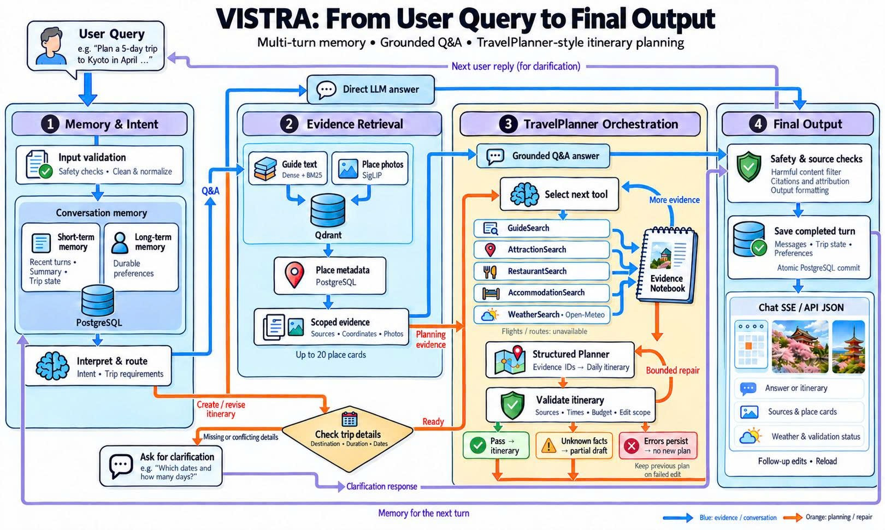

# VISTRA

**Your travel companion, with memory.**

VISTRA is an AI travel assistant for grounded Q&A and multi-turn itinerary planning. It remembers your preferences, retrieves travel guides and place photos, and brings weather into plans you can refine through conversation.

## A look inside


Chat naturally, explore photos and place details beneath each reply, and revisit your saved conversations.

## From question to trip



PostgreSQL holds short- and long-term memory; Qdrant retrieves travel evidence. Itineraries follow a TravelPlanner-style tools → notebook → planner flow, with constraint checks and bounded repair before delivery.

The pipeline now also uses optional OpenRouteService estimates to check travel time between stops.

## Get started

Use the existing `.env`, model cache, and indexed datasets. New installations need provider keys and PostgreSQL settings; see the [setup guide](api/README.md).

Run from the project root on Windows; create `.venv` with `python -m venv .venv` if needed:

```powershell
.\.venv\python.exe -m pip install -r requirements.txt
docker compose -f compose.postgres.yaml -f compose.qdrant.yaml up -d
.\.venv\python.exe -B -m frontend.server
```

Open **[VISTRA chat](http://127.0.0.1:8000)**. Try “Plan three relaxed days in Hanoi,” then “Make day two more relaxed; keep the other days unchanged.” Add your trip dates to request a forecast.

**Terminal:** run `main.py --chat`; type `/last` to inspect the full backend JSON.

**Developer API:** follow the [API &amp; Docker guide](api/README.md) to call `POST /v1/chat` with `X-API-Key`. See the [frontend guide](frontend/README.md) for chat and memory controls.
