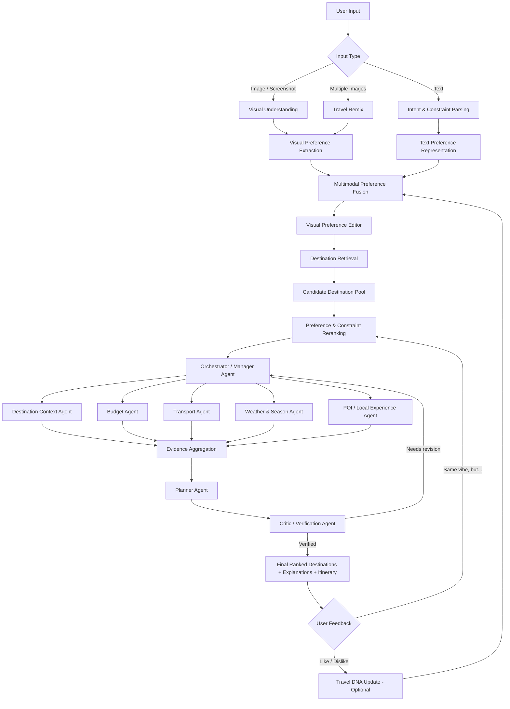

# VISTRA — Visual Intelligence System for Travel Recommendation & Agents

## 1. Summary

**VISTRA** is a multimodal, agentic travel recommendation system designed to help users discover destinations even when they **do not know exactly where they want to go**.

For the current local retrieval MVP, see [routed search examples](docs/routed_search.md).

For multi-turn chat and saved travel preferences, see [the chat service guide](src/service/README.md).

Instead of starting only from a destination name, VISTRA can accept:

- Natural-language travel requests
- One or more inspiration images
- Screenshots from social media or travel content
- Budget, trip duration, location, season, and other constraints

Its main idea is to understand **what kind of travel experience the user is visually and semantically looking for**, then discover real destinations that match that experience.

A typical request could be:

> “I want somewhere with scenery like Switzerland, streets like Kyoto, a coastal atmosphere like Amalfi, under $800, and within 6 hours from Ho Chi Minh City.”

VISTRA decomposes the request into a structured preference representation, retrieves candidate destinations, verifies them using specialized agents, ranks them according to the user's constraints, and finally generates a grounded travel recommendation and itinerary.

### Core Functions

- **Find Somewhere Like This** — upload an image and discover destinations with a similar visual/experiential style.
- **Visual Preference Editor** — expose the inferred preferences such as coast, mountains, architecture, crowd level, cafés, nightlife, nature, etc., and let the user adjust them.
- **Travel Remix** — combine different attributes from multiple inspiration images into one “dream destination” profile.
- **Same Vibe, But...** — preserve selected destination attributes while changing one constraint, e.g. cheaper, closer, warmer, less crowded, or more accessible.
- **Constraint-Aware Destination Ranking** — rank places by visual similarity, semantic preference, budget, season, weather, transport, and feasibility.
- **Multi-Agent Verification & Planning** — specialized agents verify candidate destinations and build a practical itinerary.
- **Adaptive Travel DNA (optional extension)** — learn from user feedback, likes/dislikes, saved places, and trip photos to improve future recommendations.

### Main Research / Technical Direction

VISTRA is not intended to be only an AI itinerary chatbot. Its distinctive focus is:

> **Visual preference grounding + destination retrieval + constraint-preserving recommendation + agentic verification.**

---

## 2. VISTRA Workflow



### Simplified Pipeline

```text
Text + Images + Constraints
        ↓
Intent Understanding
        ↓
Visual Preference Extraction
        ↓
Multimodal Preference Representation
        ↓
Destination Retrieval
        ↓
Constraint-Aware Reranking
        ↓
Specialized Agent Verification
        ↓
Itinerary Planning
        ↓
Critic / Feasibility Check
        ↓
Ranked Destinations + Explanation + Itinerary
```

---

## 3. Detailed Stages

### Stage 1 — User Input

#### Purpose

Collect all information the user can provide without forcing them to know a destination in advance.

#### Supported Inputs

- Natural language
- One image
- Multiple inspiration images
- Social media screenshots
- Budget
- Duration
- Origin city
- Travel dates
- Preferred climate
- Maximum travel time
- Crowd preference
- Activity preference

#### Example

```text
“I want somewhere with this type of coast, but cheaper and less crowded.
4 days, under $700, departing from Ho Chi Minh City.”
```

---

### Stage 2 — Intent & Constraint Parsing

#### Type

**Agent / structured reasoning stage**

#### Purpose

Convert free-form user text into explicit travel constraints and preferences.

#### Example Output

```json
{
  "budget_usd": 700,
  "duration_days": 4,
  "origin": "Ho Chi Minh City",
  "preferences": ["coastal", "quiet", "walkable"],
  "avoid": ["crowded"],
  "hard_constraints": {
    "max_budget": 700
  }
}
```

#### Feasible Models

- GPT-5.6 / other capable LLMs
- Qwen3
- Llama 4
- Mistral Small / Medium
- Gemini models

#### Feasible Tools

- Pydantic / JSON Schema for structured outputs
- LangGraph or custom orchestration logic
- Rule-based validation for budgets, dates, and durations

---

### Stage 3 — Visual Understanding

#### Type

**Vision / VLM stage**

#### Purpose

Understand the content, atmosphere, and visual characteristics of uploaded images.

#### Possible Visual Attributes

- Beach / coast
- Mountain / forest
- Architecture style
- Street width / walkability
- Urban density
- Color palette
- Crowd level
- Day/night atmosphere
- Café / nightlife vibe
- Historic / modern appearance
- Luxury / backpacking feel

#### Feasible Models

**VLMs**

- Qwen2.5-VL / newer Qwen-VL models
- InternVL
- LLaVA-family models
- Gemini multimodal models
- GPT vision-capable models

**Embedding Models**

- CLIP
- OpenCLIP
- SigLIP / SigLIP2
- DINOv2 for visual representation

#### Feasible Tools

- Hugging Face Transformers
- timm
- PyTorch
- OpenCLIP

---

### Stage 4 — Visual Preference Extraction

#### Type

**Agent + embedding stage**

#### Purpose

Transform image understanding into a structured representation of what the user may actually prefer.

#### Example

```json
{
  "coastal": 0.94,
  "white_architecture": 0.88,
  "quiet": 0.82,
  "cafe_culture": 0.79,
  "nightlife": 0.18,
  "crowded": 0.10
}
```

The system should distinguish between:

1. **What exists in the image**
2. **What the user actually likes about it**

This is why VISTRA should expose a **Visual Preference Editor** instead of assuming every visible feature is desirable.

#### Feasible Models

- CLIP / SigLIP embeddings
- VLM + structured attribute extraction
- Small MLP or ranking head for preference scoring

#### Feasible Tools

- Vector embeddings
- JSON structured outputs
- Interactive sliders / chips in frontend

---

### Stage 5 — Travel Remix

#### Type

**Multimodal composition stage**

#### Purpose

Combine visual properties from multiple inspirations.

#### Example

```text
Image A → landscape from Switzerland
Image B → architecture from Kyoto
Image C → coastal atmosphere from Amalfi
Text     → budget under $800
```

VISTRA builds a unified preference representation:

```text
Dream Destination
├── Mountain scenery
├── Traditional narrow streets
├── Coastal environment
├── Quiet atmosphere
└── Affordable budget
```

#### Possible Technical Approach

For image embeddings \(E_1, E_2, ..., E_n\):

\[
E_{user} = \sum_{i=1}^{n} w_i E_i
\]

where \(w_i\) represents the importance of each inspiration source.

#### Feasible Models

- CLIP / SigLIP
- VLM for semantic decomposition
- Lightweight learned fusion network

---

### Stage 6 — Multimodal Preference Fusion

#### Type

**Representation learning stage**

#### Purpose

Combine:

- visual embedding
- textual preference
- explicit user constraints
- user-adjusted preference weights

into a single representation used for retrieval.

#### Example Formula

\[
P_u = \alpha E_{visual} + \beta E_{text} + \gamma E_{explicit}
\]

#### Feasible Models

- CLIP/SigLIP shared embedding space
- Cross-attention fusion network
- MLP fusion layer
- Multimodal transformer for advanced version

---

### Stage 7 — Destination Retrieval

#### Type

**Retrieval stage**

#### Purpose

Search a large destination/POI collection for candidates whose visual and semantic properties match the user's desired experience.

#### Retrieval Score

\[
S_{retrieval}(d,u)=\cos(E_u,E_d)
\]

#### Feasible Models

- CLIP
- SigLIP2
- SentenceTransformers for text features
- Hybrid dense + metadata retrieval

#### Feasible Tools

- FAISS
- Qdrant
- Weaviate
- Milvus
- PostgreSQL + pgvector

#### Candidate Data Sources

- Wikimedia Commons
- Mapillary
- OpenStreetMap
- GeoNames
- Wikivoyage
- Tourism board open data
- Public travel image datasets

---

### Stage 8 — Preference & Constraint Reranking

#### Type

**Ranking model / agent-assisted stage**

#### Purpose

Retrieval finds visually similar destinations, but reranking determines which ones are actually suitable.

#### Possible Ranking Function

\[
Score(d)=
\alpha V+
\beta S+
\gamma B+
\delta T+
\epsilon W+
\zeta C
\]

where:

- \(V\) = visual similarity
- \(S\) = semantic preference match
- \(B\) = budget fit
- \(T\) = travel-time fit
- \(W\) = weather / season suitability
- \(C\) = crowd / popularity preference

#### Feasible Models

- XGBoost / LightGBM
- MLP reranker
- Cross-encoder reranker
- Learning-to-rank models
- LLM-based reranking for prototype version

#### Feasible Tools

- LightGBM
- XGBoost
- scikit-learn
- PyTorch

---

### Stage 9 — Orchestrator / Manager Agent

#### Type

**Agent**

#### Purpose

Coordinate all specialized travel agents.

It decides:

- which candidates need verification
- which tools should be called
- which agents run in parallel
- when additional information is required
- when a candidate should be rejected
- when the planner should revise the itinerary

#### Feasible Models

- GPT-5.6
- Qwen3
- Llama 4
- Gemini
- Mistral

#### Feasible Agent Frameworks

- LangGraph
- CrewAI
- AutoGen
- PydanticAI
- Custom Python state machine

#### Recommendation

For a research prototype, **LangGraph or a custom state-machine architecture** is preferable because agent transitions and failure states are easier to evaluate.

---

### Stage 10 — Destination Context Agent

#### Type

**Agent**

#### Purpose

Collect factual information about each destination.

#### Tasks

- Country / region
- Main attractions
- Travel style
- Safety / accessibility information
- Opening times
- General destination context

#### Feasible Models

- General LLM
- RAG-enabled LLM

#### Feasible Tools / APIs

- Google Places API
- OpenStreetMap / Overpass API
- Wikidata
- Wikivoyage
- GeoNames
- TripAdvisor-compatible data sources where legally available

---

### Stage 11 — Budget Agent

#### Type

**Agent**

#### Purpose

Estimate whether the destination is feasible under the user's budget.

#### Tasks

- Accommodation estimate
- Local transportation
- Food
- Attraction tickets
- Flights / intercity transport
- Total trip estimate

#### Feasible Models

- LLM for reasoning and explanation
- Rule-based / deterministic calculation for final numbers

#### Feasible Tools / APIs

- Flight search APIs
- Hotel booking APIs
- Numbeo-like cost datasets
- Currency conversion API
- Calculator / Python

#### Important Design Rule

Use deterministic arithmetic for final cost calculation instead of letting the LLM invent totals.

---

### Stage 12 — Transport Agent

#### Type

**Agent**

#### Purpose

Verify whether the user can realistically reach and move around the destination.

#### Tasks

- Flight routes
- Travel duration
- Local transit
- Driving distance
- Walking distance
- Intercity transportation

#### Feasible Models

- LLM for reasoning
- Routing engine for factual travel time

#### Feasible Tools / APIs

- Google Maps API
- Mapbox
- OpenRouteService
- OpenStreetMap
- Rome2Rio-style APIs where available
- Flight APIs

---

### Stage 13 — Weather & Season Agent

#### Type

**Agent**

#### Purpose

Check whether the destination is suitable for the requested dates.

#### Tasks

- Weather forecast
- Historical climate
- Rain season
- Temperature
- Extreme-weather risk
- Seasonal closures

#### Feasible Models

- LLM for summarization
- No specialized ML model required initially

#### Feasible Tools / APIs

- OpenWeather
- WeatherAPI
- Meteostat
- Open-Meteo

---

### Stage 14 — POI / Local Experience Agent

#### Type

**Agent**

#### Purpose

Find attractions and experiences that match the user's inferred travel taste.

#### Example

If VISTRA infers:

```text
quiet + architecture + café + photography
```

this agent should favor:

- historic neighborhoods
- local cafés
- scenic viewpoints
- pedestrian streets
- architecture-focused POIs

rather than generic tourist attractions.

#### Feasible Models

- Embedding model for POI similarity
- LLM for explanation
- Reranking model

#### Feasible Tools / APIs

- Google Places
- Foursquare
- OpenStreetMap
- Wikidata
- tourism-board APIs

---

### Stage 15 — Evidence Aggregation

#### Type

**Non-agent / optional agent-assisted stage**

#### Purpose

Combine outputs from all specialized agents into a single grounded candidate profile.

#### Example

```json
{
  "destination": "Candidate X",
  "visual_match": 0.88,
  "budget_fit": true,
  "estimated_cost": 640,
  "flight_duration": "4h 20m",
  "weather": "suitable",
  "crowd_level": "moderate",
  "key_POIs": ["...", "...", "..."]
}
```

---

### Stage 16 — Planner Agent

#### Type

**Agent**

#### Purpose

Convert verified destination information into a practical itinerary.

#### Tasks

- group nearby activities
- minimize travel time
- respect opening hours
- stay within budget
- match activities to user taste
- balance intensity across days

#### Feasible Models

- GPT-5.6
- Qwen3
- Llama 4
- Gemini

#### Feasible Tools

- Maps / routing API
- Calendar / timeline logic
- Optimization library such as OR-Tools for advanced scheduling

---

### Stage 17 — Critic / Verification Agent

#### Type

**Agent**

#### Purpose

Inspect the generated plan before returning it to the user.

#### Checks

- budget violation
- impossible travel times
- overlapping activities
- closed POIs
- unsupported claims
- unsuitable weather
- mismatch with user preference
- excessive itinerary density

#### Possible Output

```json
{
  "valid": false,
  "issues": [
    "Day 2 exceeds budget by $45",
    "Museum closes before scheduled arrival",
    "Travel time between POI A and B is unrealistic"
  ]
}
```

The plan returns to the manager/planner until it passes verification.

#### Feasible Models

- Same LLM as planner with a separate critic prompt
- Different model for stronger model diversity

#### Feasible Tools

- JSON Schema validation
- Deterministic constraint checker
- Maps API
- Cost calculator
- Opening-hour database

---

### Stage 18 — Final Output

#### Purpose

Return a visually understandable recommendation rather than a long generic chatbot response.

#### Suggested Output UI

For each candidate:

```text
Destination Match: 89%

Visual similarity      92%
Budget fit             95%
Weather suitability    85%
Crowd preference       82%
Travel-time fit        88%

Why it matches:
✓ Similar coastal atmosphere
✓ Walkable historic streets
✓ Strong café culture
✓ Lower cost than the original inspiration

Estimated 4-day cost: $640
```

Then provide:

- destination cards
- similarity explanation
- map
- itinerary
- budget breakdown
- travel time
- supporting images

---

## 4. Signature User-Facing Features

### Find Somewhere Like This

```text
Image → visual preference → similar destinations → constraints → ranked results
```

### Travel Remix

```text
Image A → landscape
Image B → architecture
Image C → atmosphere
Text → budget / duration

             ↓

      Dream destination
             ↓

Closest real-world matches
```

### Same Vibe, But...

Users can modify one property while preserving the rest:

```text
Same vibe, but cheaper
Same vibe, but closer
Same vibe, but warmer
Same vibe, but quieter
Same vibe, but less crowded
```

### Visual Preference Editor

```text
Ocean             ██████████ 94%
Mountains         ████████   81%
Architecture      █████████  88%
Nightlife         ██         20%
Crowds            █          10%
Café culture      ████████   79%
```

Users can edit the weights before destination retrieval.

---

## 5. Suggested Prototype Tech Stack

### Frontend

- Next.js / React
- Tailwind CSS
- Mapbox GL or Google Maps

### Backend

- FastAPI
- Python
- PostgreSQL
- pgvector / Qdrant

### AI / ML

- PyTorch
- Hugging Face Transformers
- CLIP / SigLIP2
- Qwen-VL / InternVL / API-based VLM
- LLM for agents

### Agent Orchestration

- LangGraph
- or custom Python workflow

### Retrieval

- FAISS for prototype
- Qdrant / pgvector for deployed system

### External Data

- OpenStreetMap
- Google Places
- Wikidata / Wikivoyage
- Open-Meteo
- routing API
- flight / hotel APIs where available

---

## 6. Minimal Viable VISTRA

For a first prototype, the most realistic scope is:

```text
1. Text + image input
2. VLM visual attribute extraction
3. CLIP / SigLIP destination retrieval
4. Visual Preference Editor
5. Constraint-aware reranking
6. Manager Agent
7. Weather + POI + Budget agents
8. Planner Agent
9. Critic Agent
10. Final destination cards + itinerary
```

### Recommended Features to Prioritize

1. **Find Somewhere Like This**
2. **Travel Remix**
3. **Same Vibe, But...**
4. **Visual Preference Editor**
5. **Constraint-aware destination reranking**
6. **Verified multi-agent itinerary generation**

These features give VISTRA a stronger identity than a standard AI travel chatbot.

---

## 7. One-Sentence Description

> **VISTRA is a multimodal travel intelligence system that understands the experience a traveler is looking for from text and visual inspiration, discovers real destinations that match that preference, verifies them with specialized agents, and converts the best matches into feasible travel plans.**

## 8. Configuration and current Python pipeline

[config.yaml](config.yaml) holds the shared defaults. Paths are resolved from the project root; constructor arguments and CLI options take precedence. Restart long-running processes after editing settings. The Python pipeline is under `src/`, and the FastAPI chat and map demo is under [app/](app/README.md).

| Settings | Purpose |
| --- | --- |
| `text_embedding_model`, `image_embedding_model`, `cache_folder` | Local model identifiers and cache directory. |
| `embedding_device`, `models_local_files_only` | `auto` chooses CUDA when available; use `cpu` or `cuda:0` explicitly. Set local-files-only to false to download uncached models. |
| `text_vector_size`, `image_vector_size` | Existing indexes use 2048 and 768 dimensions. Changing a model or its dimension requires a separate compatible index; code does not rebuild an existing collection automatically. |
| Storage, collection, and dataset paths | Configure Qdrant, SQLite, source dumps, processed JSONL files, images, and audit directories in one place. |
| Chunk and batch sizes | Chunking uses the text model's tokenizer. Require `0 <= chunk_overlap < chunk_size`. Batch sizes control memory use. |
| Search and ranking | `search_limit` limits final results; `retrieval_group_size` limits evidence per entity. Hybrid candidates use `max(candidate_min_limit, limit * candidate_multiplier)`. RRF combines source ranks with configured weights. |
| `destination_mappings_path`, `destination_max_distance_km` | Optional curated OSM-to-Wikivoyage mapping catalog and default proximity radius. |
| `groq_*` | Cloud model, reasoning effort, temperature, timeout, and output token limits. Keep `GROQ_API_KEY` in `.env`, outside YAML. A replacement model must support the vision and strict JSON schema requests used by the planner. |
| `app_max_upload_mb`, `app_image_max_edge`, `app_max_conversations` | Demo upload size, cloud photo resize, and in-memory conversation limits. |

`destination_mappings_path: null` allows Wikivoyage identity resolution while leaving OSM places unresolved. Image POI search remains available. To enable curated mapping, provide a version-1 JSON catalog containing `destinations` (page IDs, aliases, optional radii) and `place_mappings` (OSM place IDs, page IDs, evidence notes). IDs must reference your actual source data.

From the project root:

```powershell
./.venv/python.exe -m pip install -r requirements.txt
./.venv/python.exe -m src.service.search_service --text "quiet beaches in Vietnam"
./.venv/python.exe -m src.retrieval.image_retriever "test_sample.jpg" --limit 5
./.venv/python.exe -m unittest discover -s test -p "test_*.py"
```

The search commands reuse the existing indexes. Preprocessing commands write the configured outputs: `python -m src.data.preprocessing.parse_wikivoyage pages`, `geo`, or `articles`; `python -m src.data.preprocessing.chunk_wikivoyage`; and `python -m src.data.preprocessing.scraped_images`. Run them only when intentionally preparing datasets. Cleanup and token audit CLIs also use configured paths and retain their explicit overrides.

If `mwparserfromhell` needs compilation on Windows, set `$env:WITH_EXTENSION = "0"` before installing requirements to use its supported Python tokenizer.

`GroqPlanner` accepts a serialized search response (`dataclasses.asdict(response)`) as evidence. Destination facts and itineraries require cited guide text. Photo observations can be answered without guide citations. Live prices, weather, travel times, and booking availability are not verified.

The system, routing, and chat prompts share concise rules written with Markdown headings and lists. User-facing text fields use Markdown, with no HTML. The response envelope remains strict JSON so routing and source validation continue to work; render the text fields as Markdown in any UI.

## 9. CUDA GPU environment

The Windows `.venv` uses Python 3.14 and can use the NVIDIA RTX 3050 Laptop GPU with the CUDA-enabled PyTorch package in [requirements-cuda.txt](requirements-cuda.txt). To reproduce the GPU package setup:

```powershell
./.venv/python.exe -m pip install -r requirements-cuda.txt
./.venv/python.exe -c "import torch; print(torch.__version__, torch.cuda.is_available())"
```

With `embedding_device: auto`, `TextEmbedder` and `ImageEmbedder` select CUDA when available. Restart running Python processes after installing the GPU build. Local Qdrant uses CPU and system memory; CUDA accelerates embedding inference.

## 10. Retrieval performance

Large embedded Qdrant stores are rejected before loading to avoid exhausting
Python memory. [The performance guide](docs/retrieval_performance.md) documents
the prepared Docker service, bounded transfer of existing vectors, and interactive
timing tests. Set `qdrant_url` only after transferring both collections; the original
SQLite stores are preserved. No transfer is performed automatically.
